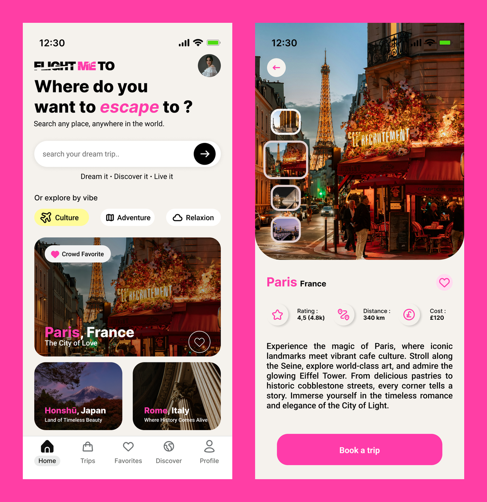
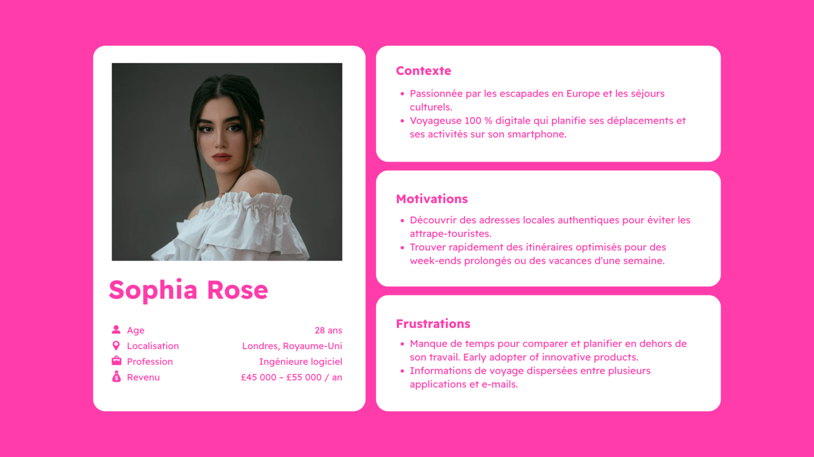

# Flight Me To · Maquette d'application de voyage (IHM)

Maquette d'une application mobile de **découverte de destinations de voyage**, conçue sur **Figma**.
L'utilisateur y trouve des destinations selon ses envies (culture, activités, bien-être), les enregistre, consulte prix, distances et avis, et réserve ses billets.

Projet de groupe du module IHM (Interfaces Homme-Machine), 1re année de Bachelor Informatique, ESGI Paris (2026).

## L'équipe

| Membre | Réalisation |
|---|---|
| Karan BLOT | Chef de projet : direction artistique, inspirations pour chaque page, pages connexion, inscription et accueil |
| André De Sousa | Pages My Trips et Discover |
| **Mouami Amoi BAKARI GANDO** | **Page Profile** et **contenu de la destination Paris** |

Le logo et la charte graphique viennent d'un projet précédent de Karan, que nous avons repris.

## Les écrans

- **Connexion et inscription**, avec états de validation des champs
- **Accueil** : recherche, destinations mises en avant, favoris
- **Découverte** : liste de destinations sous forme de cartes
- **Fiche destination (Paris)**, ma page : photo, note, distance, budget, description, bouton de réservation
- **Profil utilisateur**
- Barre de navigation commune et barre d'état iOS

## Persona

Avant de dessiner les écrans, nous avons défini notre utilisatrice type : Sophia Rose, 28 ans, ingénieure logiciel à Londres, voyageuse « 100 % digitale » qui manque de temps pour comparer et planifier ses séjours.

## Choix de design

- **Cible** : jeunes adultes de 18 à 35 ans, d'où un style épuré, moderne, avec une touche premium.
- **Rose** pour les informations importantes. Le « Me » du logo et les noms de villes sont en rose pour inviter l'utilisateur au voyage (« Vous ne voudriez pas partir à Paris ? »).
- **Jaune** pour les informations secondaires et les suggestions d'activités.
- **Navigation** en cinq onglets : Home, Trips, Favorites, Discover, Profile.
- **Interface en anglais** : les mots sont plus courts qu'en français, ce qui facilite la mise en page mobile.

## Ce que nous en avons retenu

En cours de projet, certains éléments ont été modifiés directement sur les écrans au lieu de passer par la page des composants, ce qui a cassé une partie des liaisons. Leçon retenue : toujours modifier le composant principal pour que les changements se répercutent partout.

## Compétences mises en œuvre

- **Charte graphique** et direction artistique (page dédiée dans le fichier Figma)
- Bibliothèque de **composants** avec variantes (boutons avec état au survol, icônes, barre de navigation)
- Prototypage d'un parcours utilisateur complet, de la connexion à la réservation
- Travail en équipe sur un fichier Figma partagé

## Documents

- [Note de présentation du projet](docs/presentation-projet.pdf)

## Fichier Figma

[Ouvrir la maquette sur Figma](https://www.figma.com/design/eY3gVAppk7duImsbAEb987/)
